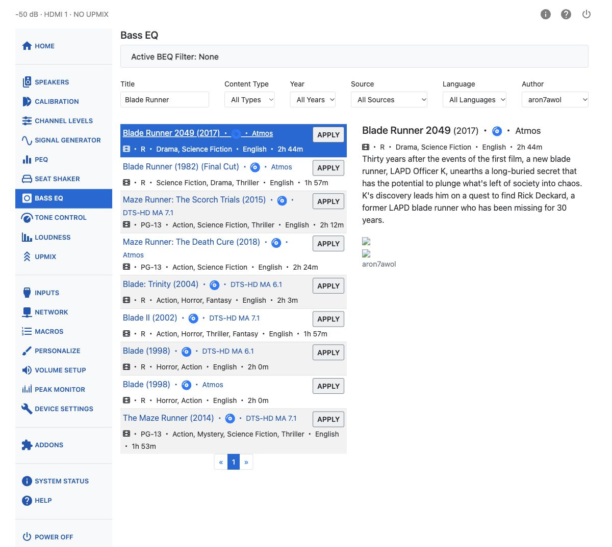
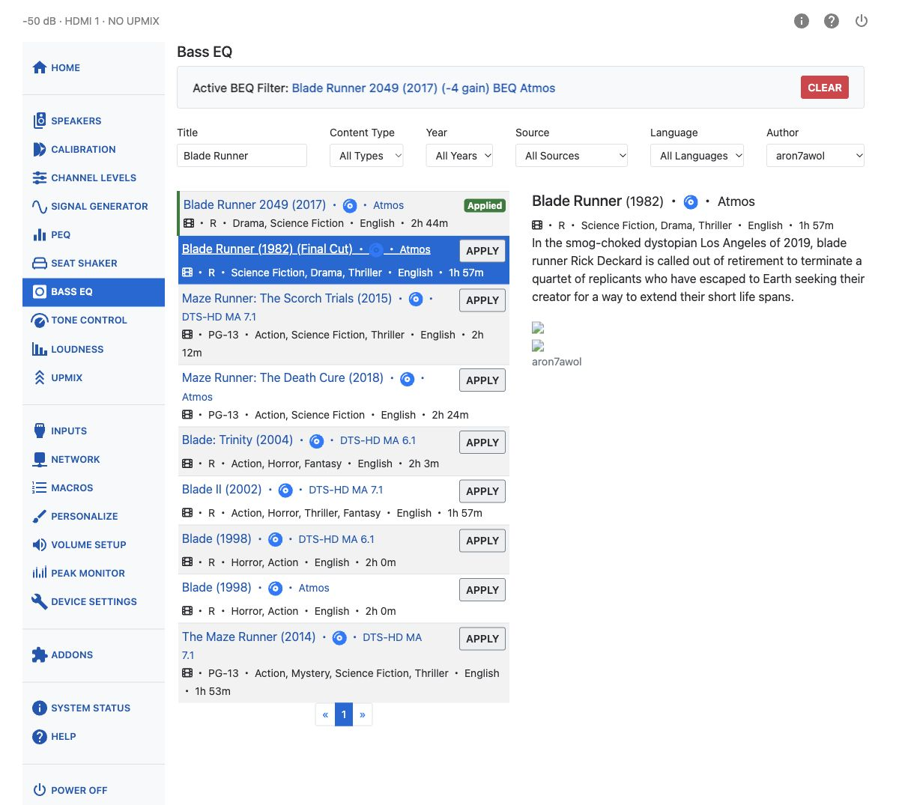

# Bass EQ

Many enthusiasts believe some movie soundtracks are high-pass filtered during mastering, reducing low-frequency content that was originally present in the mix. Bass EQ (BEQ) attempts to restore that bass using pre-made filters from the community-maintained [BEQ Catalogue](https://beqcatalogue.readthedocs.io), which contains filters for many film and TV titles. Background on the technique is available in the AVS Forum thread [Bass EQ for Filtered Movies](https://www.avsforum.com/threads/bass-eq-for-filtered-movies.2995212/).

!!! note
    Bass EQ is unavailable when PEQ is set to post-Dirac Live placement. An alert reads *"BEQ is locked because PEQ is set to post. Switch PEQ to pre to restore access."* See [PEQ Placement](peq.md#peq-placement).

## Finding a Filter

Search the catalogue using the fields at the top of the page:

- **Title** — free-text search.
- **Content Type** — Movies or TV Shows.
- **Year**
- **Source** — the streaming service, disc, or other release the filter was measured from.
- **Language**
- **Author** — the contributor who supplied the filter.

Results appear in a paged list. Select an entry to browse its details and images. Browsing does not
apply the filter. The currently applied entry has an **Applied** badge, distinct from the selected entry.

## Applying a Filter

Choose the entry matching your soundtrack's source, edition, and audio format, then click **Apply** on
its result row. The filters are written into available zero-gain PEQ bands on the active subwoofer
channels, and PEQ is switched on.

The **Active BEQ Filter** panel identifies the applied catalogue entry. Click its link to display that
entry's details.

Click **Clear** to remove the bands marked as BEQ. Those bands are reset rather than restored from a
saved copy of their previous settings. Other PEQ bands are left unchanged, and clearing BEQ does not
switch PEQ off.

Applying another BEQ filter clears the previous one first. BEQ is also cleared automatically when
changing inputs, powering off, waking from standby, or starting the unit. Automatic clearing works
with the web interface closed.
