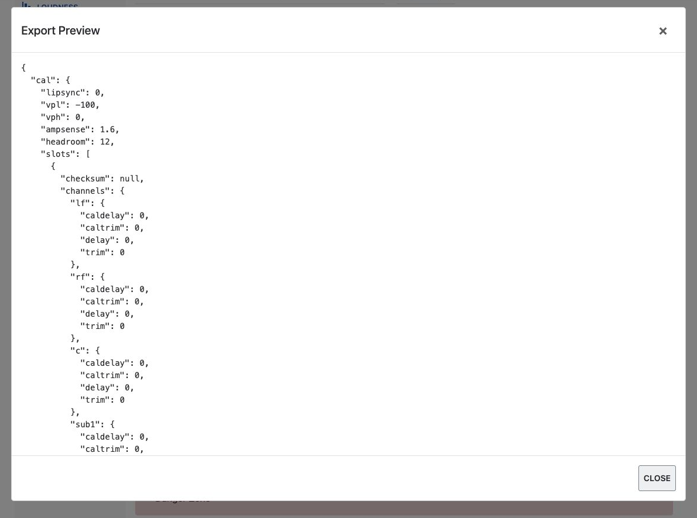
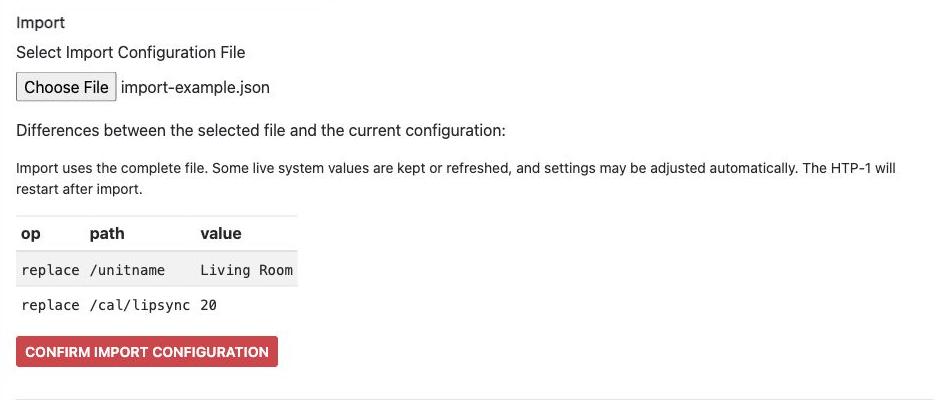
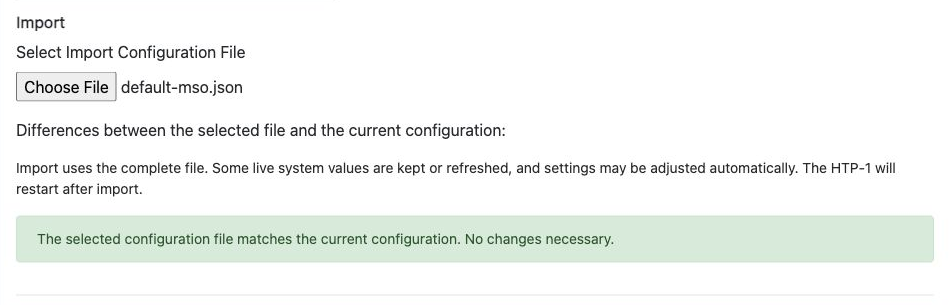

# Backup and Restore

Configs lets you save your entire HTP-1 configuration to a file and restore it later, or move it to
another unit.

## Export

Click **Show Export Preview** to open your current configuration in a scrollable dialog. Click
**Export Current Configuration to File** to save it as a JSON file.

!!! tip
    Export a backup before any major change — a firmware update, a factory reset, or a big change to
    your speaker layout or calibrations. If something goes wrong, you can restore your saved
    configuration settings.

!!! warning "Dirac Live calibrations are not included"
    A configuration export saves your HTP-1 settings but does not include the actual Dirac Live
    filter files. Keep your Dirac Live project files separately if you want to restore your
    calibrations later. Importing a configuration JSON file does not restore deleted Dirac Live
    filters.

## Import

Click **Select Import Configuration File** and choose a previously exported JSON file. The page lists
differences between the selected file and your current configuration, including additions, removals,
and changed values.

The differences are a preview, not a list of individually selectable changes. Import uses the complete
file. Some live system values are kept or refreshed, and settings may be adjusted automatically.

If differences are listed, review them and click **Confirm Import Configuration** to proceed. The
HTP-1 restarts after import.

If the file matches the current configuration, the page reports that no changes are necessary.

Nothing is changed until you confirm. Check that you selected the intended file, particularly when
importing settings from another unit or speaker layout.
