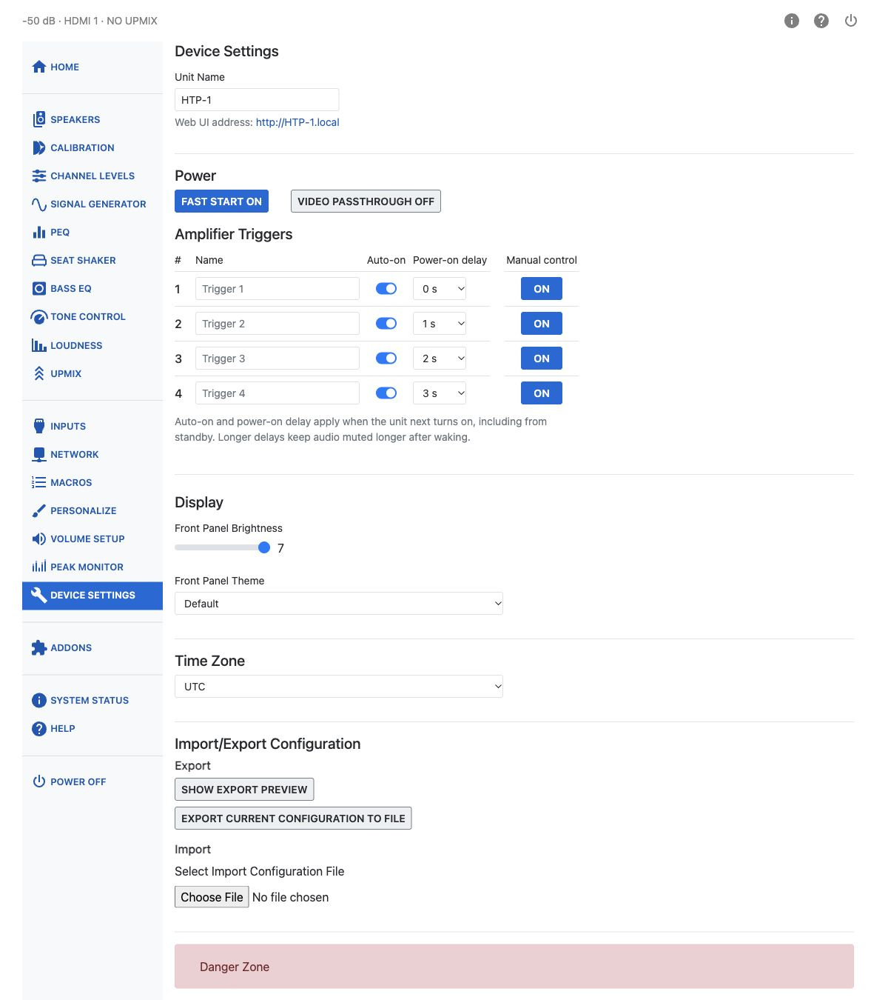

# Device Settings

Device Settings holds the controls for the unit itself — its name, how the web UI finds it, power
and display behavior, the clock, and the Danger Zone tools used for troubleshooting and reset.

## Unit Name

**Unit Name** is used for all other services the HTP-1 provides. Set it once. Spaces and capital
letters are allowed in the displayed name, though it may be truncated in some places. You should see
this name when using Dirac Live, Roon, and Bluetooth. It also determines the hostname used to access
the web UI on the local network. For reliable hostname access, use only letters, numbers, and
hyphens, with a letter or number at the beginning and end. For example, set **Unit Name** to `HTP-1`
and open `htp-1.local`.

## Power

**Fast Start** and **Video Passthrough** are two-state switches.

**Fast Start off — Slow Boot (default):** The HTP-1 powers down virtually all internal components, reducing standby power consumption to less than **0.5 W**. The front panel becomes operational in approximately **1 minute 40 seconds**, while additional initialization continues in the background and may take up to **2 minutes 30 seconds** to complete. CEC features such as automatic power-on are unavailable in this standby mode, though trigger inputs still work.

**Fast Start on:** Most internal electronics remain powered, so the HTP-1 starts almost instantly. Only the front panel is turned off while in standby, resulting in standby power consumption nearly as high as when the unit is fully powered on. Enable Fast Start using the switch on this page.

**Video Passthrough** lets video pass through the HTP-1 while the unit is in standby. It only works when Fast Start is on.

## Amplifier Triggers

The HTP-1 has four independently configurable 12 V trigger outputs, normally used to switch external
amplifiers on and off.

Each trigger can have its own name, automatic power-on setting, and power-on delay of up to 10 seconds.
Disable **Auto-on** if you don't want a trigger to activate automatically when the HTP-1 starts.

Auto-on is enabled for all four triggers by default, with delays of 0, 1, 2 and 3 seconds. A saved
delay has no effect while Auto-on is off; triggers with equal delays activate together. Changes to
Auto-on or delay apply at the next power-on, including when waking from standby, and do not alter an active sequence. Manual switching
acts immediately while the unit is on without changing the saved startup settings; switching a
trigger during startup cancels its pending automatic activation. Output changes can be recorded in
macros.

After wake from standby, audio stays muted until automatic trigger activation finishes and a short
settling time has passed. If every Auto-on switch is off, there is no trigger-related mute hold.

## Display

**Front Panel Brightness** sets how bright the front panel display is, on a scale of 1 (off) to
7 (brightest). When set to brightness 1, the front panel will briefly illuminate in response to Volume and Dialog Enhance adjustments.

**Front Panel Theme** chooses the appearance of the front panel display. The Default theme retains
the original layout; alternative themes offer additional display options.

For an alternative theme, **Front Panel Mini-Labels** lets you turn the labels on or off, choose what
each label displays, reorder them, and set their on-state colors. **Front Panel Text Color** changes
the text color throughout the alternative front-panel screens.

For alternative themes, **Restore Defaults** turns mini-labels on, restores their default
configuration, and resets front-panel text to white.

## Time Zone

Set the HTP-1's **Time Zone** from the list. This affects log timestamps and any scheduled
maintenance the unit performs in the background.

## Danger Zone

The Danger Zone holds tools for troubleshooting and reset. Each asks you to confirm before it acts.

| Button | What it does |
|---|---|
| Download Logs | Downloads a diagnostic ZIP archive containing logs and the current configuration. See [Downloading Logs](maintenance.md#downloading-logs). |
| Restart Dirac Live Server | Restarts the Dirac Live server if you're seeing issues with Dirac Live filters. Takes about 30 seconds. |
| Reload Dirac Live Filters | Reload Dirac Live Filters reloads the selected calibration for the current source sample rate and then re-enables filtering. Audio is muted briefly while it loads. Use the recovery action offered for the current status. |
| Restart avController | Restarts the avController component — the part of the system that handles most day-to-day control. Faster than a full reboot, taking about 60 seconds. |
| Factory Reset | Resets all settings to factory defaults and reboots the unit automatically. Network settings are left unchanged. |

!!! warning
    Factory Reset deletes your Dirac Live calibrations as well as other settings. A configuration
    export does not include the actual Dirac Live filter files, so importing a saved JSON
    configuration cannot restore deleted calibrations. Save your Dirac Live project files separately
    before resetting the unit. See [Backup and Restore](configs.md).
