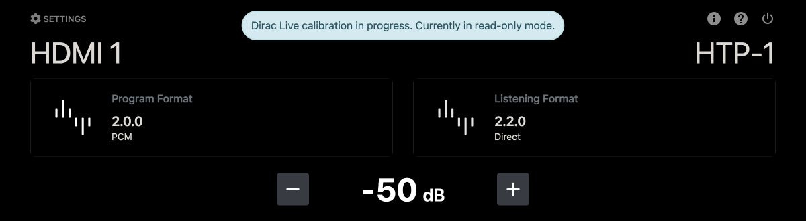
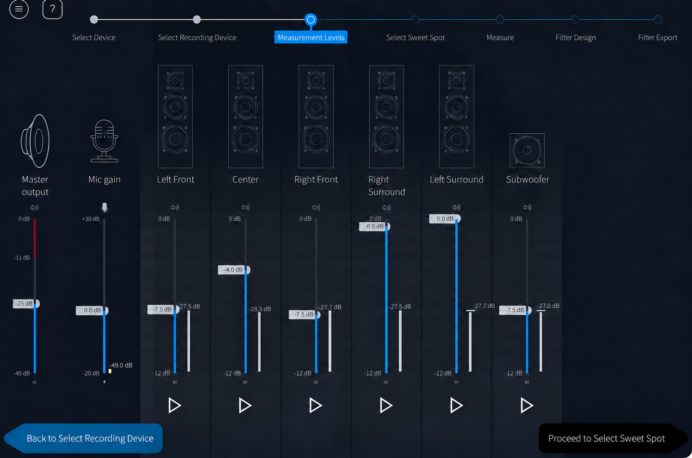
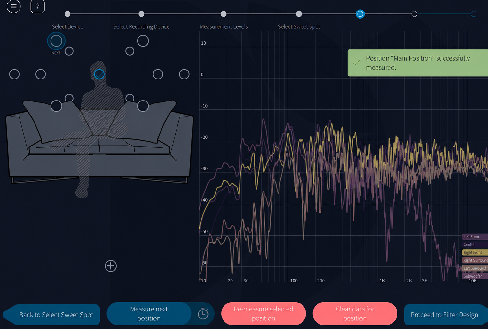
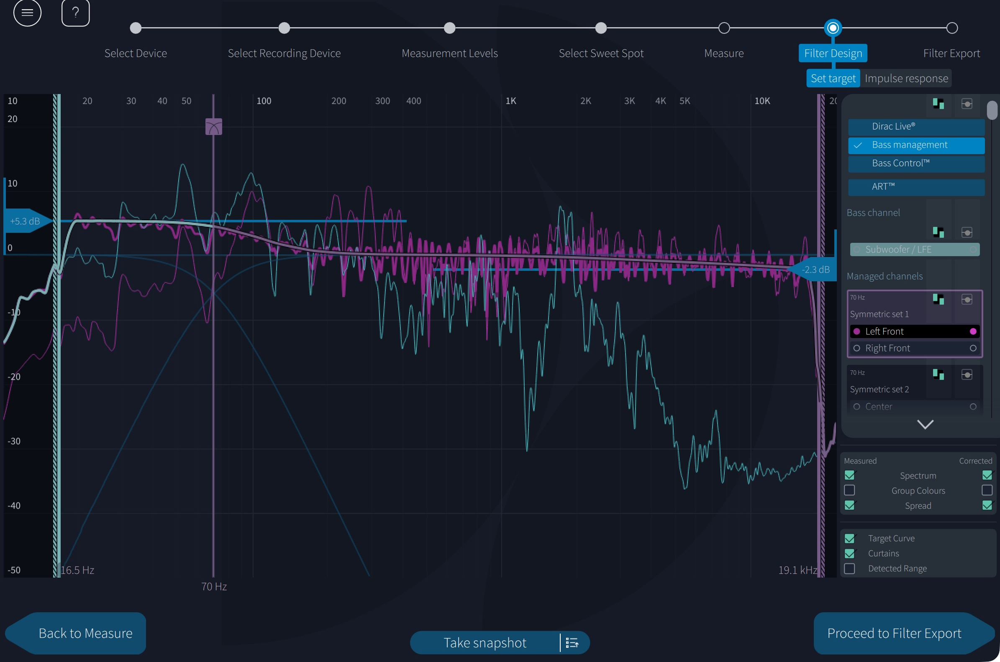
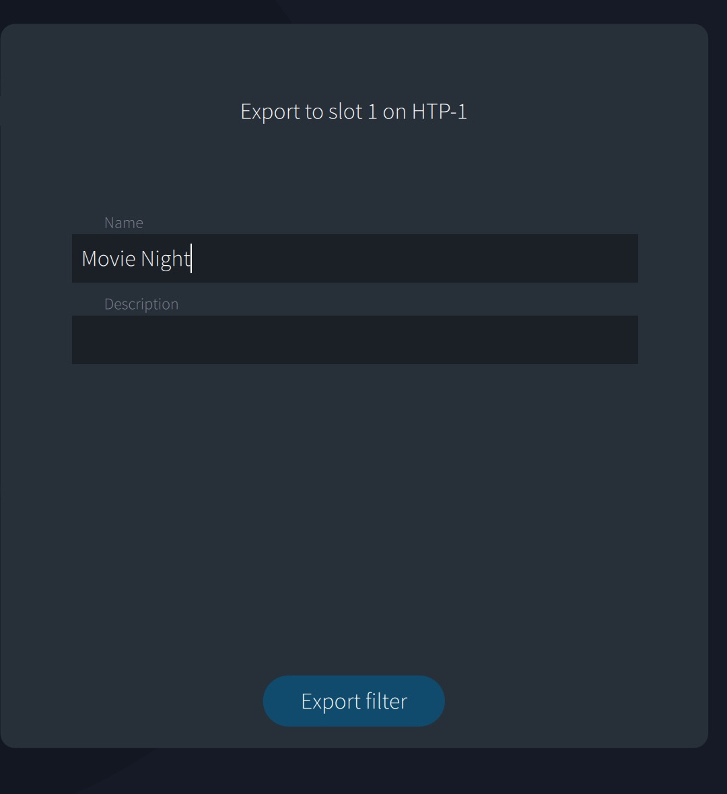
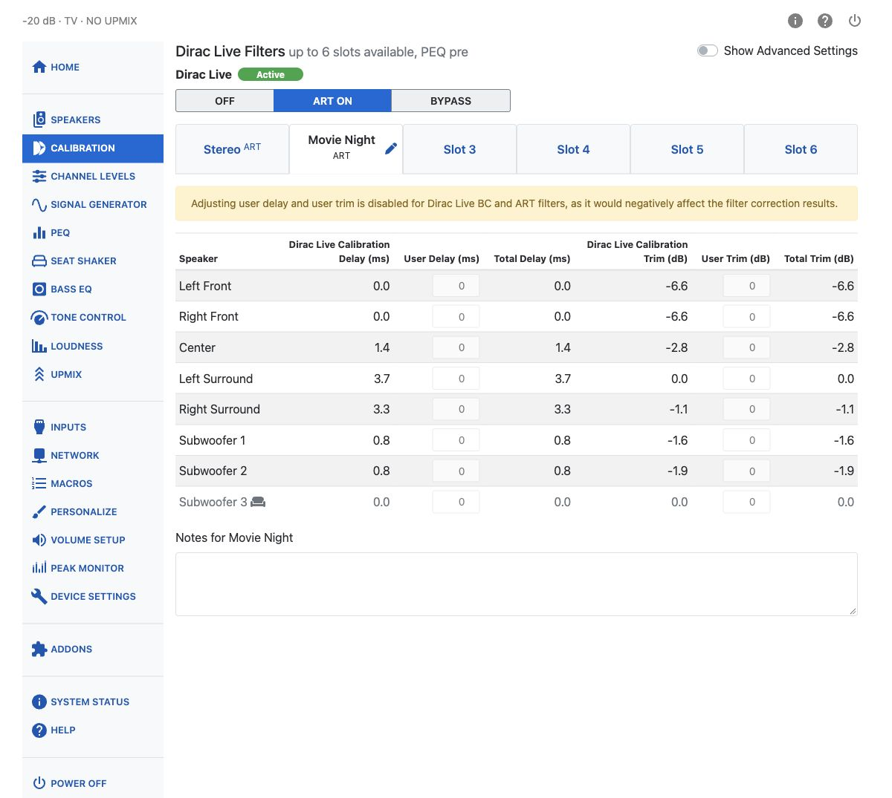
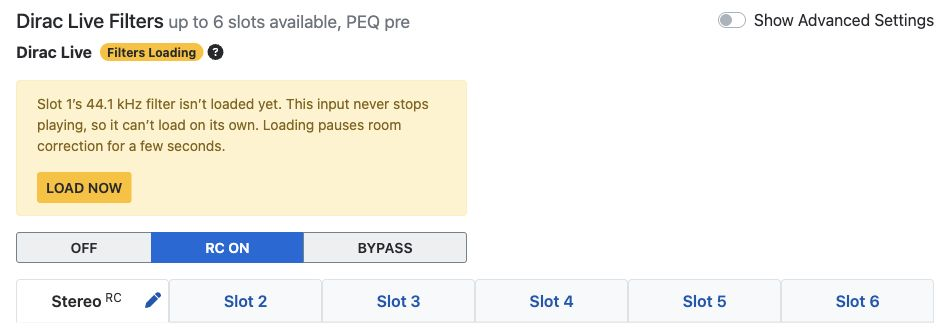
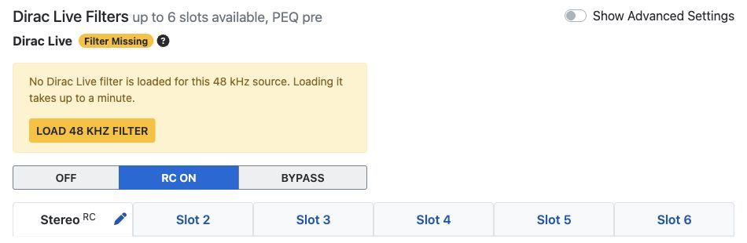
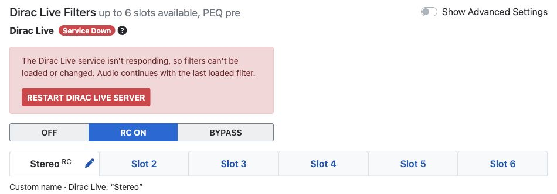

# Dirac Live

The Monolith™ HTP-1 supports Dirac Live® room correction. Using a calibrated microphone, the system
listens to the response of your room and your speakers and applies corrections to make the system
more linear and hence more correct. Calibration itself is done with the Dirac Live app on a PC or
Mac; the result is transferred to a filter slot on the HTP-1, described in
[Calibration](calibration.md).

The calibration system addresses several aspects of the system:

1. **It sets the delays on the speakers.** Sound travels about one foot per millisecond. The delays are designed to ensure that sound from all speakers reaches your ears at the same time. If the delays are not set correctly you are likely to perceive a sound in the center as coming from one side or the other.
2. **It sets the trim for each speaker.** Different speakers and amplifiers produce a different sound level for a given amplifier power. Distance also plays a role. Speaker trims are included so that the same sound from each speaker reaches your ears with the same loudness.
3. **It corrects the frequency response of the system.** The frequency response of speakers is often not flat. The Dirac Live system measures the frequency response and renders it flatter.
4. **It provides measurements of the frequency response of each of your speakers**, allowing you to set up the crossovers in the bass manager. The frequency response measurement reveals the low-frequency performance (the cutoff frequency) of each speaker. This is the information you need to set up bass management.

You should do a Dirac Live calibration. Setting up your speakers correctly is a key part of getting
the best sound out of your system.

!!! note
    Screenshots on this page illustrate the calibration steps. The appearance of the Dirac Live
    app and the HTP-1 web interface may change with software updates.

## Before You Start

- For a normal calibration, turn PEQ off or use **Pre** placement. The calibration signal bypasses
  **Pre** PEQ but passes through **Post** PEQ, so active Post filters are included in the measured
  response. See [PEQ placement](peq.md#peq-placement) for advanced uses.
  Tone control and Loudness are automatically disabled during calibration, and **User Delay** and
  **User Trim** are set to zero.
- Use the **Speakers** page to enable all of your speakers. Don't worry about crossover settings yet,
  but set any [Dolby Atmos Enabled speaker groups](speaker-setup.md#dolby-atmos-enabled-speakers)
  to **Dolby** before calibration. They should then appear in Dirac Live with "Atmos" in the speaker
  name, and Dirac Live will preserve their specially designed frequency response.
- A calibrated USB microphone is required. Using an uncalibrated mic, or a laptop's built-in mic,
  will skew the frequency response of your system.

### Multiple Subwoofers with Dirac Live Bass Management

Connect all subwoofers to a **single HTP-1 subwoofer output**, using a suitable signal splitter,
distribution device, or the subwoofers’ supported daisy-chain connections. Enable only that one
subwoofer output in the HTP-1 speaker configuration. Dirac Live then measures and corrects the
subwoofers together as one system.

With separate subwoofer outputs, regular Room Correction and Bass Management optimize each
subwoofer independently. They do not optimize how the subwoofers combine acoustically, so the
combined response can differ substantially from the individual responses shown in the Dirac Live app.

This recommendation also applies to Room Correction used with the HTP-1’s own bass manager.
Bass Control and ART provide joint optimization and support individually connected subwoofers.

Dirac® calibration requires a PC or Mac laptop running the Dirac Live app with an external mic
attached to the laptop.

!!! note
    The HTP-1 requires the desktop version of Dirac Live. The mobile Dirac Live app cannot be used because the HTP-1 does not provide the external microphone support required by the mobile app.

## Calibration Steps

Complete the [basic setup](basic-setup.md) first — be able to play sound through your speaker set.

These steps use Dirac Live Room Correction with Bass Management, included with the HTP-1.
Dirac Live handles room correction, speaker delays and levels, and bass management, including
crossovers. When this calibration is active, it replaces the HTP-1’s own bass manager.

Bass Control and ART are optional, separately licensed upgrades.

1. Download and install the Dirac Live app: <https://live.dirac.com/download/>. Use the latest
   version for the best results.
2. Attach a calibrated USB microphone to the computer.
3. Launch Dirac Live and log in. The HTP-1 includes Dirac Live Room Correction
   with Bass Management.
4. Open Dirac Live and connect to the Monolith HTP-1. The Dirac Live app finds the HTP-1 using
   common networking protocols. The name it shows is the HTP-1's name, set on the **Device
   Settings** page.

    

5. Choose the microphone you have connected.
6. The HTP-1 web UI is read-only while a Dirac Live calibration session is connected — a banner
   tells you this, and the front panel and remote still work for volume. Closing the Dirac Live app
   restores normal control.

    

    *A connected Dirac Live calibration session temporarily puts the HTP-1 web interface into read-only mode.*

7. Set the volumes for calibration. The volume control on the left side of the Dirac Live screen
   matches the one on the remote control — you can adjust it with the remote. The app sets the
   volume initially to -34 dB.

    Use the Dirac Live **Measurement Levels** screen to make sure the test signal is well above the room
    noise floor without clipping. A good target is roughly 20 dB of separation between the ambient
    noise floor and the test signal, with more being better if the room is quiet.

    1. Start with the master output low and raise the microphone gain until the background noise is
       just below the -50 dB mark, or barely peaking above it. If the room is noisy, reduce the mic
       gain and use a louder test signal level; if the room is quiet, you can use more mic gain and a
       lower test signal level.
    2. Move all speaker and subwoofer channel sliders to their maximum, then turn the subwoofer's
       own gain or level control down as a precaution. If the subwoofer has a low-pass filter, make
       sure it is switched off or set to the highest value.
    3. Click the play button for the left front speaker and slowly raise the master output until
       that channel plays at a comfortable level. The noise plays for about 30 seconds; press play
       again if you need to. Then click the play button for each speaker in turn and note which one
       is the softest. Omit the subwoofer for this step.
    4. Click the play button for the softest speaker and raise the master output until that channel
       reaches at least roughly -20 to -30 dB on the meter, which is about 20 dB above the noise
       floor. Then click the play button for the left speaker and reduce its level so it also falls
       into that range. Repeat this for all other speakers except the subwoofer.
    5. Move the subwoofer channel slider roughly to the same value as the loudest speaker, then click
       the play button for the subwoofer and turn the subwoofer's own gain or level knob up until it
       also reaches the same target range. Do not use the Dirac Live subwoofer slider for this step;
       the adjustment should be made on the subwoofer itself.

    

8. Proceed to the **measure** screen and hear the sweeps. When a measurement completes you'll see
   the frequency response displayed. A single sweep is fine for trying things out, but a good
   calibration uses more measurements.

    

    If the volume is too low, the calibration will fail for "missing samples" or "poor signal to
    noise ratio". If it's too high, it will fail with clipping. If a run fails, go back to the
    volume page and adjust. Also check that your speaker configuration is correct: if you set up
    for 7.1.4 but have only 7.1.2, the missing speakers show as "missing samples".

9. The Dirac Live app encourages multiple sweep locations. Try a calibration with one location
    first to become familiar with the process, then do a full set of measurement locations for a
    better correction.
10. Proceed to the **Filter Design** screen, select **Bass management**, and see the correction Dirac Live suggests. You can drag
    the left and right endpoints, investigate the cutoff frequency for your speakers, and grab the
    dots to adjust the target curve. With Dirac Live Bass Management you can drag the crossover
    point and recalculate. Dirac Live's default target curve has a slight downward tilt at the low
    end; most users want more bass than that default:

    

11. The "groups" at the right let you view one set of speakers at a time.
    Review the target curve and crossover response for each speaker group.

12. Choose a slot to store this calibration in. The HTP-1 has up to six Dirac Live filter slots
    (the exact number is shown on the Calibration page heading). You can store calibrations for
    different room configurations, like curtains open and closed, or for different speaker layouts.
    Dirac Live suggests the names of physicists and philosophers; this name is visible in the HTP-1
    UI, so choose something meaningful to you. The description is not visible in the HTP-1 UI, but
    you can add your own note to the slot afterward — see [Calibration: Notes](calibration.md#notes).

    

13. Export the filter. This takes a minute or two. When complete, the resulting filter is installed
    and enabled on the HTP-1. You can see this on the [Calibration](calibration.md) page.
14. Save the session as a Dirac Live "project" on your PC before you exit. Each project contains one
    calibration session and is tied to your HTP-1's serial number. A project can't be transferred to
    a different serial number, but you can ignore the warning that results from changing the name.
15. Close the Dirac Live app. The read-only banner on the HTP-1 should clear. If it doesn't, launch
    the Dirac Live app again, then close it.
16. Open the HTP-1 web UI and go to **Calibration** (`#/settings/calibration`). If a calibration
    does not match your current speaker layout, the page displays a warning. Check your speaker
    configuration and the calibration you selected.
17. The calibration delay and trim values shown are what Dirac Live measured, applied whenever that
    filter is active. Notice that the delay and trim on one channel may read zero — that speaker was
    farthest from the microphone during calibration.

    

You can add **User Delay** and **User Trim** on top of the calibration values — see
[Calibration](calibration.md#the-delay-and-trim-table). These are only editable for RC and BM
filters; BC and ART filters lock them, since adjusting delay or trim downstream of those
calibrations would work against what the filter is doing. Total Delay cannot go below zero. Setting
trim to a large value can work, but it sacrifices headroom you may want for other filters.

## Dirac Live State: Off / Bypass / On

In the web interface, select **Off**, **Bypass**, or **On** directly. The On button also identifies
the active calibration type, such as **ART On**.

The physical remote's **Dirac** button cycles through **Off → On → Bypass → Off**.

A slot without a Dirac Live calibration can still be used for manual adjustments. Selecting it
switches Dirac Live off while retaining global PEQ and the slot's user delay and trim settings.

### Off

Dirac Live filtering and its calibration delay and trim are disabled. User Delay and User Trim
remain applied. The HTP-1’s own bass manager is used, regardless of the selected filter type.
The button reads **Off**.

### Bypass

Dirac Live filtering is disabled, but the calibration’s delay and trim remain applied, along with
User Delay and User Trim. The button reads **Bypass**.

- **RC:** The HTP-1’s own bass manager remains in use. Bypass lets you compare room correction on
  and off while retaining calibration delay, trim, and the same bass-management settings.
- **BM, BC, or ART:** Bass management switches from Dirac Live to the HTP-1’s own bass manager.
  The audible difference therefore includes changes in bass management, rather than room
  correction alone.

!!! note
    Before using Bypass with a BM, BC, or ART filter, check the HTP-1’s speaker size and crossover
    settings. These settings are independent of the Dirac Live calibration and are not automatically
    synchronized. Matching crossover frequencies does not guarantee identical bass management.

### RC On / BM On / BC On / ART On

Dirac Live filtering and the calibration’s delay and trim are active. The button identifies the
filter type, such as **RC On** or **ART On**.

- **RC:** Dirac Live provides room correction; the HTP-1’s own bass manager handles bass management.
- **BM, BC, or ART:** Dirac Live provides room correction and bass management; the HTP-1’s own bass
  manager is disabled.

User Delay and User Trim can be adjusted with RC and BM filters. These adjustments are locked
for BC and ART filters.

If the current speaker layout has no calibration in any slot, the button instead shows a single
**No Filter** state.

With a Dirac Live calibration active, the system may sound noticeably quieter than with Dirac Live
off because the calibration can apply substantial negative trim values.

!!! tip
    If you switch between On and Bypass often, consider a macro that does it in one press. See
    [Macros](macros.md).

## Dirac Live Status

The status indicator shows whether Dirac Live is working correctly, preparing filters, or needs
attention. Its label and color provide more information than a simple on/off indication.

| Status | Meaning |
|---|---|
| Off / Bypass | Dirac Live filtering is intentionally disabled or bypassed. |
| Ready | Dirac Live is enabled and ready to process audio when playback starts. |
| Active | The correct filter is loaded and confirmed active for the selected slot and source. |
| Loading / Applying / Checking | A filter operation is in progress or the processor's state is being verified. |
| Filter Missing / Wrong Filter | The required filter is missing or the processor has loaded a different filter than expected. |
| Not Applied / Still Applied | The processor's actual filtering state does not match the selected setting. |
| Load Failed / Service Down / Setup Failed | A filter operation or service has failed and needs attention. |

The Calibration page provides a detailed explanation when something needs attention. The Home page
also shows a notice for problems that require action.

When recovery is possible, the interface offers an appropriate button, such as **Load 48 kHz filter**,
**Load correct filter**, **Apply Dirac Live again**, or **Restart Dirac Live Server**.

Follow the action suggested by the interface. Restarting the Dirac Live server is not always
necessary and will not resolve every missing-filter problem.

## Tips for a Successful Dirac Live Calibration

Dirac Live is generally not too sensitive to small differences between calibrations, but a few tips
can help it go more easily.

- Make an initial measurement (one set of sweeps only) in the center of the sound stage, equidistant
  from and between the front left and right speakers, even if there is no seat there. After
  calibrating, check this by comparing the front left and front right Dirac Live Calibration Delay
  values on the Calibration page — they should be equal or very close.
- For the first measurement only, the mic should be at ear height in the main seat. For the UMIK-1,
  the mic should point straight up, its tip at ear level, using the 90-degree calibration file.
- A single measurement is useful for testing, but won't give Dirac Live enough information for a
  calibration that sounds good — it may sound dry and dull. More data produces better results.
- Try to match speaker volumes using amplifier volume controls before relying on the sliders in the
  Dirac Live app.
    - Establish proper levels for all speakers, including the sub channel, at the start of
      calibration. Dirac Live reduces the gain of speakers that are too loud but does not add gain
      for speakers that are too quiet — a speaker or group that starts too low will pull every
      channel's final level down to match it, which can be frustrating and require a much higher
      master volume to reach normal listening levels afterward. User trims can absorb differences of
      a few dB; differences of 10 dB should be fixed at the amplifier instead.
- Take remaining measurements several inches above and below the first mic position. For example,
  if your seated ear height is 41 inches: take the first measurement at 41 inches, the next several
  around 49 inches, and the rest around 33 inches. Precision matters less for these later positions,
  but a consistent routine helps.
- No two mic positions should be closer than about a foot to each other, and don't reuse a position
  for multiple measurements.
- Keep mic positions at least a foot from reflective boundaries where possible. If seat backs sit
  close to a mic position, fully recline the seat during calibration.
- At every mic position, the mic tip should have a clear line of sight to every speaker except
  subwoofers. Reclining seats can help with rear speakers.

## Calibrating for Higher Sample Rates

The Dirac Live filter itself does not run above 48 kHz; a sample rate converter drops the rate to
48 kHz range whenever the filter is active. Calibration runs at the sample rate of the active input.
44.1 kHz input is supported for calibration; 48 kHz is recommended.

<!-- verify: whether Dirac Live Bypass mode also avoids engaging the sample rate converter, or only the RC/BM/BC/ART filter itself -->

!!! tip
    You might reserve one filter slot just for a "user only" set of delay and trim values, with no
    room-correction filter loaded.

## Room Correction Methods and PEQ

A slot's calibration is one of four types, shown as a small badge after the slot name:

| Type | What it is |
|---|---|
| **RC** — Dirac Live Room Correction | Standard correction; each speaker and subwoofer is treated individually. |
| **BM** — Dirac Live Bass Management | Like RC, but Dirac Live's own bass management replaces the HTP-1 bass manager. |
| **BC** — Dirac Live Bass Control | Like BM, with added optimization across multiple subwoofers — delays and filters are tuned to smooth the response over the listening area. |
| **ART** — Dirac Live Active Room Treatment | All speakers are optimized together as a matrix rather than one-to-one, using every speaker's measured capability to reproduce the content best at the listening position. |

BC and ART both require phase alignment that a later delay or trim change would disturb, so both
lock out User Delay and User Trim on the Calibration page. Use [Channel Levels](channel-levels.md)
for a permanent trim adjustment under either filter type.

Dirac Live Room Correction is included with the HTP-1. Bass Control and Active Room Treatment require
separate licenses from [Dirac](https://www.dirac.com/products/monoprice-htp-1-monolith). ART also requires
Bass Control when using one or more subwoofers. An existing Bass Control license satisfies that
requirement; an ART license is still required.

A more comprehensive overview of Dirac Live ART™ is available at
<https://www.dirac.com/live/art-technology/>.

### Filter Storage and Slot Behavior

#### Filter Preparation

Each Dirac Live calibration uses separate filter versions for the 44.1 kHz and 48 kHz sample-rate
families.

After a firmware update, the HTP-1 checks the filters for the current speaker layout and prepares
any missing versions. This can take several minutes during the first startup. Missing versions may
also be prepared automatically when the unit is idle.

Missing filters normally load automatically when nothing is playing. If the selected input
continuously reports playback, the interface offers **Load now**. Loading pauses room correction
for a few seconds.

When changing speaker layouts, the HTP-1 transfers the required filters to the audio processor.
The progress display identifies the filter being loaded and shows an estimated remaining time when
available.

When switching calibration slots, the HTP-1 keeps audio muted until the selected setup has loaded
and been verified. Some controls are temporarily unavailable during this operation.

#### Slot Behavior

- **Filters reload on speaker-layout change.** Whenever the speaker layout changes, filters for the
  new layout are loaded into a cache on the DSP. While a filter transfers, a progress overlay shows
  on screen. Once cached, switching between installed calibrations for the same layout is fast.
- **Filters are layout-specific.** If the current speaker layout has no calibration in any slot, a
  warning explains this and lists the layouts that do have a calibration:

    > Dirac Live is disabled; there are no Dirac Live filters available for the current speaker
    > layout.

- **Mismatched layouts are flagged.** If the selected calibration does not match the current
  speaker configuration, a warning appears on the Calibration page:

    > The selected Dirac Live calibration does not match the current speaker configuration.

  Check the speaker layout and selected calibration. Speakers that are not covered by a calibration
  pass through without filtering; user delay and trim can still be added to them.
- **Subwoofer mismatches are not flagged.** Using a calibration made with more or fewer subwoofers
  than your current layout will still produce sound, but not optimally: extra subs get a copy of the
  first sub's signal, and a layout with fewer subs than the calibration only gets the primary sub
  signal.
- **The Dirac Live app can affect HTP-1 slots.** Deselecting all filters in the app disables Dirac
  Live on the HTP-1. Deleting a slot in the app removes that slot's user delay and trim on the HTP-1.
  Transferring a new filter into a slot resets that slot's user delay and trim to zero.
- **Speaker-dependent delay is capped at about 35 ms** (roughly 35 feet, or 10.7 meters, of distance
  difference to the listener). If your room would need more, the applied delay may be zero for the
  affected speaker — worth knowing if you're calibrating a very large room.

## Troubleshooting

### Resolving Dirac Live Problems

If Dirac Live reports a problem, open the **Calibration** page and read the displayed message.

- **Filter Missing or Wrong Filter:** Use the offered filter-loading button.
- **Not Applied or Still Applied:** Apply the selected Dirac Live setting again. If this fails,
  the interface may recommend restarting the Dirac Live server.
- **Load Interrupted:** Load the filter again when prompted.
- **Service Down or Setup Failed:** Use **Restart Dirac Live Server** when offered.
- **Cache Damaged:** The stored calibration may need to be transferred again from the Dirac Live app.

Some filter loads may be refused when no audio is playing. If a load cannot be completed, start
playback and try the suggested recovery action again.

Dirac Live does not support 32 kHz audio. If the interface reports an unsupported sample rate,
switch Dirac Live off while playing that source.

!!! tip
    Loading several calibrations for a large speaker layout can take several minutes. Wait until
    the filter transfer has finished before changing the configuration again.

!!! note "Speaker layout after upgrading from a 1.x release"
    Check that the Speakers page shows your intended layout before running a new calibration. See
    [Upgrading from Version 1.x](maintenance.md#upgrading-from-version-1x) for the migration procedure.
