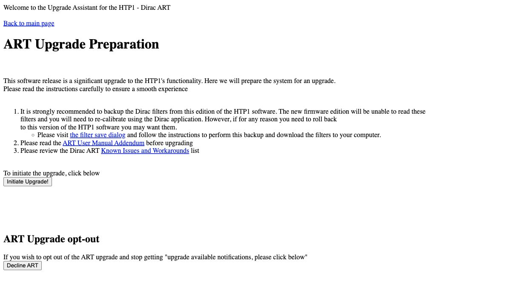

# Updates and Support

## Checking Your Version

Open [System Status](system-status.md) to see the software version currently installed and whether
a newer release is available.

Click **Check for updates** to refresh the information. If the release server is unreachable, the
page explains the problem and may show information from the last successful check.

## Version History

Click **Version history** on the System Status page to see available software releases.

Version history lists available firmware versions, release dates, release notes, and installation
options. Enable **Show release candidates and betas** to include versions that are still being tested.
These may contain new features and fixes but are not yet final releases.

## Installing an Update

Select the version you want to install and click **Install**. You can also reinstall the currently
installed version or return to an older version listed in Version history.

Review the release notes before installing, then confirm your selection.

Version history is also accessible while the HTP-1 is in standby through
**View version history and install updates**.

!!! tip
    Export your configuration before updating. See [Backup and Restore](configs.md).
    Configuration exports do not include Dirac Live filter files.

## What to Expect

During installation, the web interface displays progress messages and a progress bar. Installation
may take several minutes. Do not disconnect power while the update is running.

The HTP-1 restarts automatically when installation finishes. Open browser tabs reconnect and reload
when the unit becomes available again.

During startup, you may see **HTP-1 is starting** or **Preparing Dirac Live filters**.

The first startup after updating may take longer because the HTP-1 checks its stored Dirac Live
filters and prepares missing filter versions.

Your existing settings and calibrations are preserved during a normal firmware update.

## Upgrading from Version 1.x

Moving from version 1.x to version 2 replaces the Dirac Live filter system. Existing version 1.x
filters cannot be used by version 2; you will need to run a new Dirac Live calibration.

This is a one-time migration. If your HTP-1 already runs version 2.x, use the normal update procedure
above.

Before starting, export your configuration and keep your Dirac Live project files separately. A
configuration JSON export does not include the Dirac Live filters.

### Prepare and Install

1. While still running version 1.x, use its software-update controls to install **version 1.13.3**.
   This release includes fixes for the upgrade process and speaker-layout preservation.

2. After the update finishes, open the **Info / Detailed Status** page and follow the
   **ART Preparation** link. If you previously declined the upgrade, use **Prepare for ART Upgrade**.

    

    *Legacy version 1.13.3 — ART Upgrade Preparation for upgrading from version 1.x.*

3. Before initiating the upgrade, follow the preparation page's link to the filter-save dialog.
   Click **prepare for download**, wait for preparation to finish, then save the files for your
   occupied filter slots to your computer. Audio is interrupted during preparation. These files are
   useful only if you return to version 1.x; they cannot be imported into version 2.

4. Return to **ART Upgrade Preparation**, read the information provided, and click **Initiate Upgrade!**

5. Allow the installation and automatic restarts to finish. Do not disconnect power during the upgrade.

6. Once version 2 is running, check the installed version on **System Status**. Use **Version history**
   to install a newer public release if needed, following the normal update procedure above.

### Your First Calibration Afterward

Check that the **Speakers** page shows your intended speaker layout before starting Dirac Live.
Correct the layout if necessary and wait for any configuration operation to finish.

Run a new Dirac Live calibration and transfer the resulting filters to the HTP-1. The filters used
under version 1.x are not available for playback under version 2.

Review your Volume Setup and Calibration settings after migration. The upgrade resets
calibration-related configuration, so do not assume that every previous value has carried over.

If Dirac Live reports a problem, follow the status message and recovery action on the **Calibration**
page. See [Dirac Live](dirac.md#dirac-live-status).

!!! warning "Returning to version 1.x"
    Returning to version 1.x requires the dedicated downgrade procedure rather than a normal
    version-history installation. It removes the version 2 filters and attempts to restore the
    pre-upgrade filters. Restoration is not guaranteed. Keep your downloaded version 1.x filter
    backups and Dirac Live project files separately.

## Support

### Downloading Logs

Open **Device Settings → Danger Zone** and click **Download Logs**. This downloads a diagnostic ZIP
archive containing logs and the current configuration. Its filename includes the unit's serial number
and the download date and time. Review the archive before sharing it publicly.

Send this file along when you report a problem — it gives the development team the detail needed
to reproduce and diagnose it.

### Community Discussion

Much of the HTP-1 owners' discussion about setup, troubleshooting, features, and software updates
takes place in the
[AVS Forum HTP-1 owners thread](https://www.avsforum.com/threads/the-official-monoprice-monolith-htp-1-owners-thread.3112176/).
You can also find this link under **Discussion** on the [System Status](system-status.md) page.

### On-Device Help

Click the **?** icon to open Help for the current page in a side panel without leaving your
settings.

To browse all available Help topics, select **Help** in the settings sidebar. The online User Manual
provides more detailed explanations.
