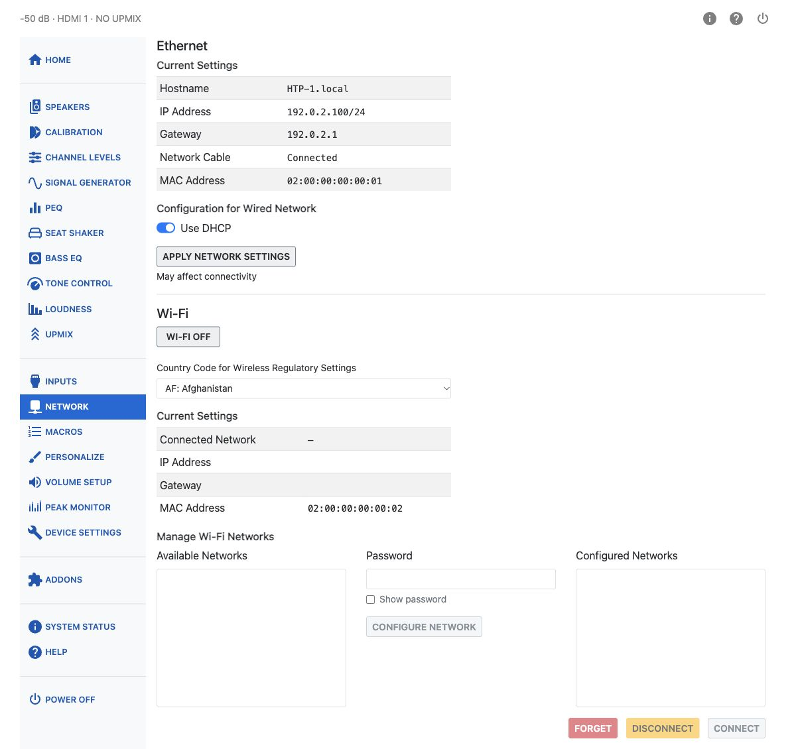
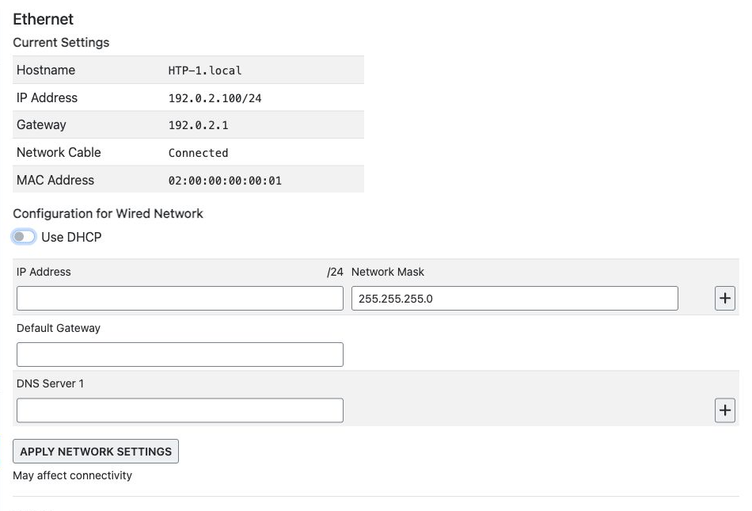

# Network

The Network page sets up the HTP-1's wired and wireless network connections.

## Ethernet

The **Current Settings** table shows the wired connection's Hostname, IP Address, Gateway, whether the
Network Cable is Connected or Disconnected, and the interface's MAC Address.

!!! note
    Version 2.2.0 restores gigabit Ethernet operation after updating and restarting the HTP-1.
    Earlier releases limited the connection to 100 Mbit/s to work around a compatibility problem.
    If DHCP still fails, check the cable and router or switch, then try reconnecting the Ethernet cable.

Under **Configuration for Wired Network**, leave **Use DHCP** on to obtain network settings automatically.

To use a static IPv4 address, turn **Use DHCP** off. Enter an **IP Address** and **Network Mask**, along
with the **Default Gateway** and **DNS Server** addresses required by your network. For example, the
mask `255.255.255.0` appears as `/24` beside the IP Address label.

Use the plus and minus buttons to add or remove address and DNS rows. Click **Apply Network Settings**
when finished. Invalid entries produce an error message and are not sent.

**Settings sent** confirms that the configuration was sent; it does not confirm that the new connection
is working. Changing the address may disconnect your browser. Reopen the web interface at the new
address if necessary.

If no Ethernet cable is connected, this section prompts you to connect one before you can configure
the wired network.

## Wi-Fi

Turn on the **Wi-Fi** button to enable the Wi-Fi radio. Make sure the antenna that came with the unit
is connected to the gold SMA antenna connector on the rear panel.

Set **Country Code for Wireless Regulatory Settings** to your country. This affects which Wi-Fi
channels and transmit power levels the HTP-1 is allowed to use, so pick the country you're actually
in.

Once connected, a **Current Settings** table shows the Connected Network, IP Address, Gateway, and
MAC Address for the Wi-Fi interface.

### Manage Wi-Fi Networks

**Available Networks** lists nearby Wi-Fi networks. The HTP-1 rescans automatically every five
seconds while this page is open — there is no separate Scan button, and scanning stops once you
navigate away.

Select a network from the list, enter its **Password** (turn on **Show password** if you want to
check what you typed), and press **Configure Network** to add it.

**Configured Networks** lists networks you have already set up. Select one to enable **Forget**,
**Disconnect**, and **Connect** for it. DHCP or static addressing for that network is set up
underneath, in a **Configuration for Wi-Fi Network** panel identical in layout to the Ethernet one.

!!! note "Dirac Live and Wi-Fi"
    Third-party tools like the Dirac Live calibration app may not find the HTP-1 if both network
    interfaces are enabled. Choose either wired or wireless for calibration.

## Resetting the Network Connection

To reset the network connections, tap the Help (?) icon at the top right of the front panel, then tap
**Reset Network**. This returns Ethernet and Wi-Fi to automatic configuration using DHCP.
