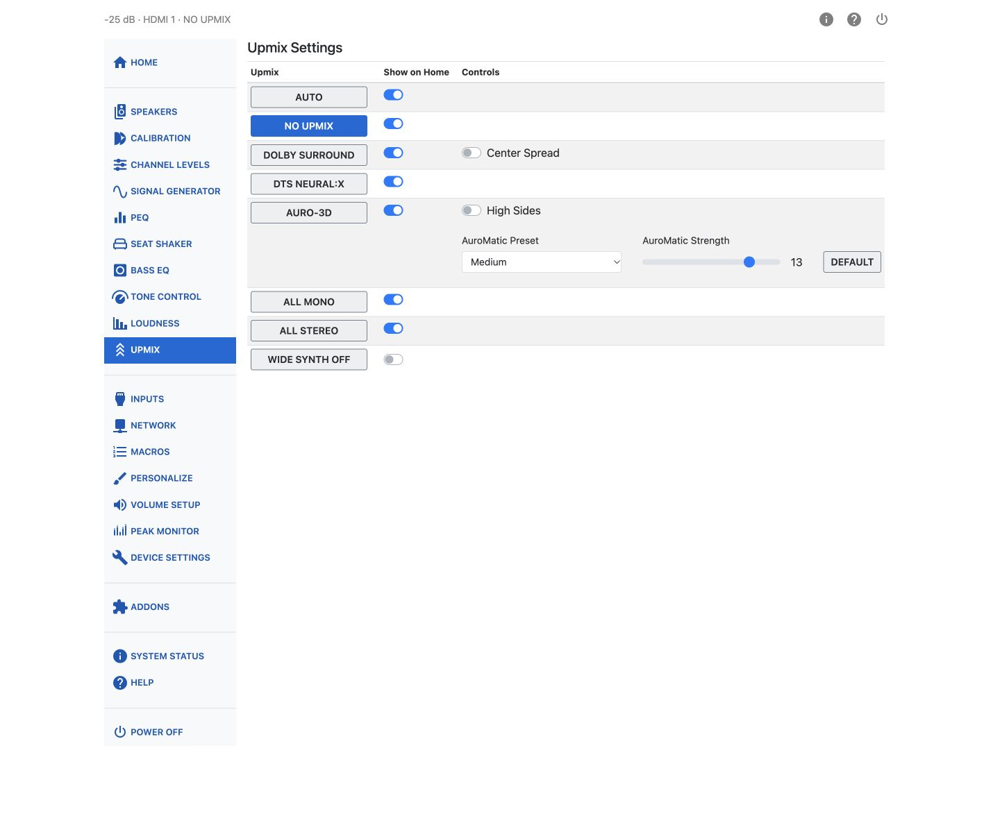

# Upmix

An upmixer takes an input signal and maps it to more speakers than it was originally mixed for —
for example, spreading a stereo or 5.1 soundtrack across a full height and wide speaker layout.
The Upmix page lists the available listening modes, lets you select one, choose whether it appears
as a button on the Home page, and adjust its settings. These modes include upmixing and no
upmixing. **All Mono** and **All Stereo** distribute the downmixed source across all speakers.

You request a listening mode through the interface, but the requested mode may not always be
possible. The current mode is shown in the audio status. This is most often noticed when you
request something like AURO-3D but the source is Dolby Atmos or DTS-X — only All Mono and All
Stereo can override a native Atmos or DTS-X stream.

## Available Listening Modes

| Listening mode | Description |
| --- | --- |
| AUTO | Automatically chooses the listening mode associated with the source format: Dolby Surround for Dolby sources, DTS Neural:X for DTS sources, and the AURO-3D decoder for AURO-3D content. PCM sources are not upmixed. |
| NO UPMIX | No upmixing algorithm is applied. Other processing — including channel levels, bass management, tone control, loudness, PEQ and enabled Dirac Live filters — still applies. Whether the subwoofer is engaged depends on the bass management settings on the Speakers page. See the sample-rate guidance below for high-resolution content. |
| DOLBY SURROUND | Dolby's own upmixing algorithm, an evolution of the older Pro Logic algorithms. It uses cues in the signal to route sound to the speaker set, including extracting material common to left and right into the center channel. It works with any combination of available speakers, though some channels may stay silent depending on the source — a mono input produces sound only from the center channel. It does not generate wide channels. |
| DTS NEURAL:X | DTS's own upmixing algorithm, an evolution of the older Neo algorithms, following the same kind of rules as Dolby Surround. Neural:X natively outputs up to 12 channels (7.1.4). |
| AURO-3D | Auro Technologies' Auro-Matic algorithm, again extracting common left/right material to the center channel. When upper speakers are present the effect is called Auro 3D; without upper speakers it becomes Auro 2D. Auro-Matic is not applied to 192 kHz content. |
| ALL MONO | Downmixes the source to mono and sends the same signal to all speakers. |
| ALL STEREO | Downmixes the source to stereo. The left signal goes to all left speakers and the right signal to all right speakers; the center receives a mono mix. |

!!! note
    Dolby Atmos and DTS-X streams play in their native format and cannot be requested or replaced
    by another upmixer, except by All Mono or All Stereo.

## Sample Rates and No Upmix

**No Upmix** is the only mode that presents program material at its original sample rate, which makes
it the mode to use for high sample rate content at 96 kHz or 192 kHz. Every other upmixer runs the
signal through a high quality sample rate converter that reduces the output to 48 kHz (or 44.1 kHz).

Dirac Live filters also limit the sample rate to 48 kHz. If you want to take advantage of high
sample rates, disable Dirac Live filtering as well as choosing No Upmix.

## Show on Home

Each listening mode has its own **Show on Home** switch. Turn this on for the modes you switch
between often, so they appear as buttons on the Home page.

## Dolby Surround: Center Spread

When Dolby Surround is selected, a **Center Spread** switch becomes available. Turning it on
spreads the center channel signal to the left and right front speakers as well, in addition to the
center.

## AURO-3D Controls

Selecting AURO-3D reveals three additional controls:

- **High Sides** — when off, high side content is mixed to the rear height or top rear speakers.
  When on (the default), it is mixed to the top middle speakers instead.
- **AuroMatic Preset** — one of **Small**, **Medium**, **Large**, **Movie**, or **Speech**. This
  shapes how much the Auro-Matic upmix behaves like an added-reverb effect.
- **AuroMatic Strength** — a slider from 1 to 16 controlling how much of the Auro-Matic signal is
  mixed into the original. A **Default** button restores the factory value.

## Wide Synth

Most source material does not include dedicated wide-channel content, even though Dolby Atmos can
carry objects placed there. Dolby Surround does not produce wide channels, and Neural:X outputs
12 channels (7.1.4), so DTS:X configurations can provide upper front and rear channels but no top
middle channels.

**Wide Synth** generates signals for the wide channels and/or the top middle channels when speakers
are present but the decoded audio contains no signal for those channels.

The synthesized signals are derived using principles based on Michael Gerzon's research. Wide Synth
creates new channel content from adjacent channels — for example, the left wide channel is
synthesized from the left and left surround channels.
